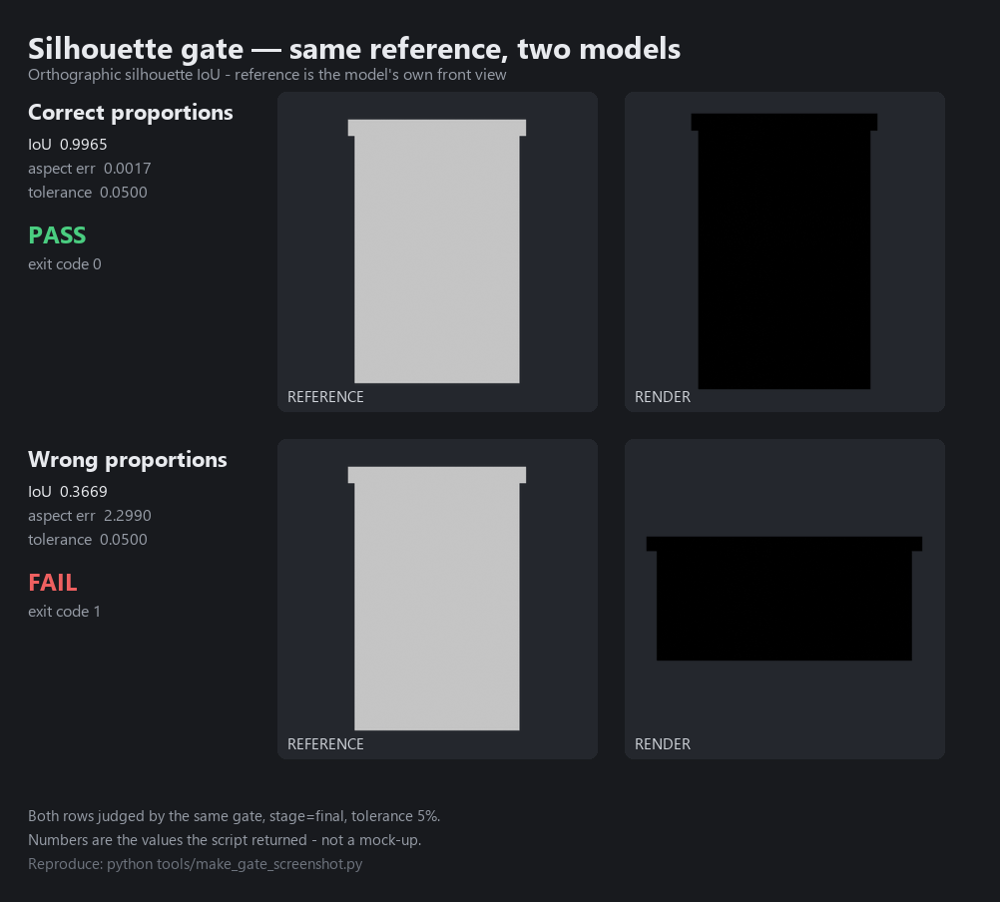

# game-dev-skills

[](https://github.com/huayuehua15-netizen/gamedev-agent-skills/actions/workflows/ci.yml)
[](LICENSE)

**English** · [简体中文](README.md)

An AI skill kit for game development. Four skills, one repo, one set of
verification gates that actually exit non-zero. **3D first, with a concrete
2D track** (see [2D support](#2d-support-what-works-and-what-does-not) below).

> **Positioning**: stop the AI from doing careless things; only ship what can pass a check.
> It does not promise "the AI will make good-looking models" — art direction, taste and
> game feel still need a human.
>
> **Why bother**: most game-dev skills are advice you cannot act on — "mind the proportions",
> "make sure performance is good". The core of this repo is a set of **scripts that return
> exit codes**. Topology out of budget exits 1. Silhouette mismatch exits 1. The model
> cannot hand-wave past it with "I think it looks fine".

## Quickstart (30 seconds)

```bash
git clone https://github.com/huayuehua15-netizen/gamedev-agent-skills.git
cd gamedev-agent-skills
python tools/build.py                    # generate per-host artifacts into dist/
python tests/test_silhouette_gate.py     # sanity check the gate math (no Blender needed)
```

Then pick your host:

```bash
# Cursor / Codex: install into your project
python tools/install.py --target cursor --path /path/to/your-project
python tools/install.py --target codex  --path /path/to/your-project

# Any host that reads SKILL.md (DSH, Trae, ...)
python tools/install.py --target generic --path ~/.your-host/skills

# Claude Code: no install, use the plugin marketplace
/plugin marketplace add https://github.com/huayuehua15-netizen/gamedev-agent-skills
```

Just want the gates, without installing anything? Run a script directly:

```bash
blender --background --python-exit-code 1 --python plugins/blender-modeling-craft/skills/blender-modeling-craft/scripts/topology_audit.py -- your_asset.blend --budget-tris 3000
```

## Which skill do I need?

| Your situation | Skill | What you get |
|---|---|---|
| "I have an idea but can't turn it into something a team can build" | `aaa-game-gdd` | 12 document types + single-page templates + scaffolder, each with a definition-of-done checklist |
| "The models the AI makes look like stacked boxes" | `blender-modeling-craft` | Scale / blockout / topology / UV workflow + a **silhouette IoU gate** that blocks export |
| "I downloaded a pile of 3D assets and they all break in Unity" | `unity-blender-mcp` | Asset-first decision tree + audit and cleanup + FBX export + Unity import postprocessor |
| "The GDD is written, where does the code start?" | `unity-gameplay-dev` | Compilable C# framework + input / interaction / UI / save / AI + scaffolder |
| "I'm making a 2D game" | All four, with caveats | See [2D support](#2d-support-what-works-and-what-does-not) |

## The four skills

| Skill | Owns | Explicitly does not own |
|---|---|---|
| `aaa-game-gdd` | Turning an idea into a dispatchable, verifiable document set (12 doc types + templates + scaffolder) | No art, no code |
| `unity-blender-mcp` | Asset-first pipeline: search and reuse → audit → clean → FBX → Unity import verification | Will not sink time into modelling from scratch |
| `blender-modeling-craft` | Craft and geometry gates when you do build from scratch: scale, blockout, topology, UV, silhouette comparison | No rigging or animation |
| `unity-gameplay-dev` | GDD into playable features: input, controllers, interaction, UI, systems, AI, tests, builds | No assets, no multiplayer |

## 2D support: what works and what does not

Stated plainly so nobody gets burned:

| Stage | 3D | 2D |
|---|---|---|
| Design docs (`aaa-game-gdd`) | Complete | Partial: the frame-animation spec (09) is directly usable; scene/level docs need rewriting around a tile grid |
| Asset pipeline (`unity-blender-mcp`) | Complete | Limited: `AssetPostprocessor.cs` has a Sprite branch that applies 2D import settings automatically, but the asset libraries are still 3D-oriented |
| Modelling (`blender-modeling-craft`) | Complete | Not applicable: Blender is not where pixel art and sprites live |
| Gameplay code (`unity-gameplay-dev`) | Complete | **Dedicated doc** `references/11-2d-gameplay.md`: 2D package setup, sprite import, Physics2D, Tilemap, pixel-perfect camera, overdraw budgets. The dimension-agnostic C# (event bus / state machine / inventory / save / UI stack / audio) is reusable. **A controller is included**: `PlatformerController2D` (Rigidbody2D + coyote time + jump buffer), generated automatically by `--dimension 2d`, which also skips the 3D-only files. Navigation still has to be built (2D uses grid A*, not NavMesh) |

The scaffolder supports `--dimension 2d`, which adds the `com.unity.2d.*` packages;
`AssetPostprocessor.cs` routes anything under `spr_*` / `*_spr` / `/Sprites/` / `/Tiles/`
through sprite import so the 3D texture rules cannot destroy it.

## Repository layout

```
game-dev-skills/
├── marketplace.json                 # ZCode / bundled marketplace manifest
├── .claude-plugin/marketplace.json  # Claude Code marketplace manifest (generated)
├── LICENSE
├── README.md                        # Chinese
├── README.en.md                     # this file
├── CONTRIBUTING.md                  # contribution standards and pre-submit checks
├── CHANGELOG.md                     # version history, including every gate defect
├── .gitattributes                   # normalise line endings across platforms
├── tools/
│   ├── build.py                     # generate per-host artifacts into dist/
│   ├── install.py                   # cross-platform installer (Windows/macOS/Linux)
│   ├── install.ps1                  # Windows installer (equivalent)
│   └── make_gate_screenshot.py      # regenerate the README gate image from real runs
├── tests/
│   └── test_silhouette_gate.py      # gate math unit tests (no Blender required)
└── plugins/
    ├── aaa-game-gdd/
    │   ├── .zcode-plugin/plugin.json
    │   └── skills/aaa-game-gdd/
    │       ├── SKILL.md
    │       ├── references/          # 00-12, read on demand
    │       ├── assets/templates/    # 12 doc templates + single-page templates
    │       └── scripts/new_gdd.py
    ├── blender-modeling-craft/
    ├── unity-blender-mcp/
    └── unity-gameplay-dev/
```

Every skill follows the same layering: `SKILL.md` holds only the boundaries, the hard rules
and the index; `references/` is read on demand; `scripts/` are the executable checks;
`assets/` holds templates and data.

## Compatibility and installation

The skill itself is `SKILL.md` (Anthropic Agent Skills format). The outer
`marketplace.json` is only a packaging manifest. Run the generator once, then install
per host:

```bash
python tools/build.py          # everything lands in dist/
```

| Host | Artifact used | Install |
|---|---|---|
| Claude Code | repo-root `.claude-plugin/` | Push to Git, then `/plugin marketplace add <repo-url>` |
| Cursor | `dist/cursor/` | `python tools/install.py --target cursor --path <project>` |
| Codex | `dist/codex/` | `python tools/install.py --target codex --path <project>` |
| Trae | `dist/skills/` | `python tools/install.py --target trae --path <skills-dir>` |
| Any SKILL.md host (incl. DSH) | `dist/skills/` | `python tools/install.py --target generic --path <skills-dir>` |
| Upload-based (Claude.ai etc.) | `dist/upload/*.zip` | Upload each zip in settings |
| ZCode | root `marketplace.json` | Import the plugin marketplace, no copying |

`tools/install.py` runs on Windows, macOS and Linux. Windows users can also use
`tools/install.ps1` with equivalent arguments:
`powershell tools/install.ps1 -Target cursor -Path <project>`.

Three things worth being explicit about:

1. **Only Claude Code supports genuine linked installation** (`/plugin marketplace add <git-url>`).
   Cursor and Codex have no remote install mechanism; installing really means copying the
   skills into your project and generating a rules entry point.
2. **Scripts do not run automatically under Cursor or Codex.** Their rules can only tell the
   model which `SKILL.md` to read; the Blender and Unity scripts still have to be run by hand.
3. **`unity-blender-mcp` and `unity-gameplay-dev` depend on MCP.** Without MCP support in your
   host, those two degrade to documentation only. `aaa-game-gdd` needs nothing but file access.

## The core: verification gates

The valuable part of this repo is not the prompts. It is **the part a machine can judge**.



That image is not a mock-up. Both rows are judged by **the same script against the same
reference image**, and the numbers are the values the script returned:

| Model | IoU | Aspect error | Tolerance | Result | Exit code |
|---|---|---|---|---|---|
| Correct proportions | 0.9965 | 0.0017 | 5% | PASS | `0` |
| Wrong proportions (squashed and widened) | 0.3669 | 2.2990 | 5% | FAIL | `1` |

To the eye both "look like a crate". The gate disagrees. That is the entire point.

```bash
# `--python-exit-code 1` is NOT optional.
# Blender treats a Python exception as success (exit code 0) by default. Without this flag,
# a crashed script or a failed gate looks like "passed" to your CI and to the agent.
# This is the single most important line in this repo.

# 1) Topology and poly budget (non-zero exit on failure; triangle count includes modifiers)
blender --background --python-exit-code 1 --python scripts/topology_audit.py -- asset.blend --budget-tris 3000 --require-bevel

# 2) Silhouette gate: turn "does it look right" into a number
blender --background --python-exit-code 1 --python scripts/qa_render.py -- asset.blend \
    --gate --ref-front refs/front.png --ref-side refs/side.png \
    --stage final --outdir out

# 3) Unity side: drop the bundled AssetPostprocessor.cs into Assets/Editor/
#    Normalises scale, normals and texture channels; 2D art (spr_*/Sprites/Tiles)
#    is routed through sprite import automatically.
```

Exit code contract (implemented, safe to wire into CI):

| Exit code | Meaning |
|---|---|
| `0` | Passed |
| `1` | The review failed (over budget / silhouette mismatch / audit warnings) |
| `2` | Bad arguments or input (missing file, misspelled flag, nothing to audit) |

The gate math has unit tests that do not need Blender installed:

```bash
python tests/test_silhouette_gate.py
```

How a silhouette is judged:

- **IoU**: orthographic render (Workbench flat colour, transparent film), cropped to the
  bounding box, scaled uniformly and compared as intersection over union.
- **Aspect ratio is checked separately**, so stretching to fill the frame cannot hide a
  proportion error.
- Thresholds: blockout IoU `0.70` / aspect error `10%`; final IoU `0.85` / aspect error `5%`.
- Failing the gate **blocks export**; the report is written to `qa_gate.json`.
- **Quantisation tolerance**: the aspect ratio is counted from a pixel bounding box, so the
  fewer pixels on the short side, the larger the rounding error. The gate adds a tolerance
  derived from short-side pixel count (capped at 15%) and writes
  `aspect_tol_effective`, `quant_tolerance_applied` and `short_side_px` into the JSON.
  **The tolerance is disclosed, not a quiet loosening.**
- **Adaptive render resolution**: above a 4:1 aspect ratio the silhouette render resolution
  is raised automatically so the short side has at least 48 pixels.

> An honest note on the thresholds: because both masks are normalised to the same longest
> edge, **a 5% aspect error implies IoU >= 0.95**. So at the `final` stage the aspect check
> dominates. The IoU number does its real work at the `blockout` stage (0.70), where it
> catches "one leg too many, one arm missing".

### Gate credibility self-test

```bash
python tools/check_toolchain.py     # build fixtures -> run every gate -> assert the decisions
```

Eight assertions covering the *quality of the decisions*, not just that the
scripts ran:

```
PASS  topology: good asset passes                       exit=0
PASS  topology: unapplied transform rejected            exit=1
PASS  topology: missing file exits 2                    exit=2
PASS  silhouette: matching asset passes (IoU>=0.85)     exit=0 iou=1.0
PASS  silhouette: wrong proportions rejected            exit=1 iou=0.3534
PASS  turntable: renders 4 views                        exit=0 images=4
PASS  silhouette: typo'd flag fails, not silently ignored
PASS  silhouette: misspelled stage fails, not silently defaulted
8/8 passed
```

Measured on Blender 5.2.2: self-comparison passes at 1:1, 2:1, 5:1, 10:1, 20:1 and 40:1,
while genuine shape errors (IoU 0.10 - 0.49) are all rejected. No false negatives,
no leaks.

> **What CI can and cannot do (stated plainly)**: GitHub's ubuntu runner has no GPU.
> Blender's Workbench rendering is unreliable there — after installing libEGL and
> Mesa, a small render succeeds but 512x512 RGBA always fails. So CI runs only the
> **five checks that need no GPU**: three topology decisions plus two argument-validation
> checks, with `BLENDER_SKIP_RENDER=1` set explicitly.
>
> **The silhouette gate and turntable renders are verified only on a machine with GL**
> (that is where the 8/8 output above comes from). This is not hidden: the environment
> requirement is stated here rather than pretending CI covers everything.

### Unity templates: compiled for real

The 22 C# templates were compiled in a **real Unity 6000.0.84f1** editor via batchmode:

| Check | Result |
|---|---|
| `GateTest.dll` / `GateTest.Tests.dll` emitted | 45056 / 5632 bytes |
| Compile errors (`CS####`) | 0 |
| `InventoryTests` EditMode tests | 3/3 passed |

To reproduce (replace `<Unity>` with your editor path):

```bash
python plugins/unity-gameplay-dev/skills/unity-gameplay-dev/scripts/new_gameplay.py \
    --out "<project>/Assets/Game" --namespace YourGame
"<Unity>" -batchmode -quit -projectPath "<project>" -logFile build.log -nographics
grep "error CS" build.log          # should print nothing
```

> **The first run will report missing InputSystem. That is by design.** A brand-new project
> has not downloaded the package yet, so the scaffolder cannot read the InputSystem asmdef
> GUID. Open Unity once so the package downloads, **re-run the scaffolder** to backfill the
> GUID, then compile. That is the order the table above was verified in. It is the only
> "must run twice" step in this repo, and it is documented in
> `unity-gameplay-dev/SKILL.md`.

## Known limitations (read this first)

1. Reference images must be **orthographic** front/side silhouettes (transparent or flat
   background, no perspective, no drop shadow, no gradient). Feeding a perspective product
   photo to `--stage final`'s 0.85 threshold will always fail because the near face is wider
   than the far face — that is the photo's fault, not the model's.
2. The silhouette gate only checks the outside contour and proportions. It cannot check
   detail, materials or character. A model that looks completely wrong but has the right
   outline will pass.
3. Self-review by the model is close to worthless: in most environments the agent cannot see
   the render. Judge with a script, not with "looks fine to me".
4. The Unity baseline is Unity 6 / 6000.x with the new Input System.
5. The C# templates compile on Unity **6000.0.84f1** (zero errors, 3/3 tests passing) but are
   **not verified** on 6000.3, on the Built-in render pipeline, or on non-Windows platforms.
   They guarantee "compiles and is internally consistent", not "drop-in for your exact setup".
6. Extremely thin objects (aspect ratio >40:1) can still be unstable because of pixel
   sampling. Combine the number with a human look.
7. The gates cover **geometry and proportion only**. File naming, material correctness and
   licence compliance are not checked automatically.
8. 2D is not "3D with a different camera": physics, navigation and the budget model are all
   different. See [2D support](#2d-support-what-works-and-what-does-not).

## A note on language

The skills themselves (`SKILL.md`, `references/`, templates) are written in **Chinese**, because
they are tuned for Chinese-speaking developers and the prompt engineering depends on that
phrasing. This repo's code, scripts and gates are language-neutral — they work the same
regardless of what language the agent speaks. If you need English skill content, the scripts
and gates are still directly usable; translating `references/` is a welcome contribution.

## Contributing

See [CONTRIBUTING.md](CONTRIBUTING.md). The most valuable PRs either fix a fact that would
mislead someone, or make a gate actually block something. Please attach an authoritative
source or real measured output for either.

## Licence

MIT, see [LICENSE](LICENSE).
