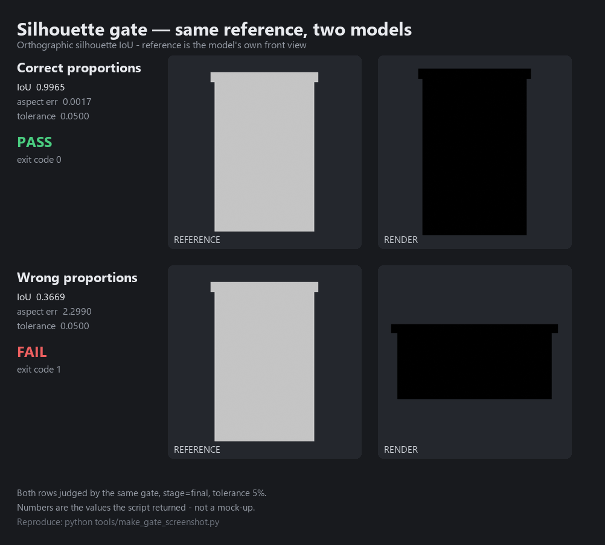

# game-dev-skills

[](https://github.com/huayuehua15-netizen/gamedev-agent-skills/actions/workflows/ci.yml)
[](LICENSE)

面向游戏开发的 AI 技能套件。四个技能，一个仓库，一套可执行的验收门禁。**3D 为主，2D 有专门的落地方案**（见下文「2D 支持边界」）。

> 定位：让 AI 不做蠢事、交付能过检查的东西。
> 它不承诺"AI 能做出好看的模型"——造型方向、美术判断、玩法手感仍然需要人。
>
> **为什么值得用**：市面上多数游戏开发 skill 只写"要注意比例""要保证性能"这类无法判定的建议。
> 这套东西的核心是一批**能返回退出码的脚本**：拓扑不合格就退出 1，剪影不符就退出 1，
> 让模型无法用"我觉得可以了"糊过去。

## 30 秒上手

```bash
git clone https://github.com/huayuehua15-netizen/gamedev-agent-skills.git
cd gamedev-agent-skills
python tools/build.py                    # 生成各宿主产物到 dist/
python tests/test_silhouette_gate.py     # 自检：门禁数学是否正常（不需要 Blender）
```

然后按你的宿主选一条：

```bash
# Cursor / Codex：装进你的项目
python tools/install.py --target cursor --path /path/to/your-project
python tools/install.py --target codex  --path /path/to/your-project

# 任何认 SKILL.md 的宿主（含 DSH、Trae）
python tools/install.py --target generic --path ~/.your-host/skills

# Claude Code：不用装，走插件市场
/plugin marketplace add https://github.com/huayuehua15-netizen/gamedev-agent-skills
```

只要最核心的门禁、不想装任何东西？直接跑脚本：

```bash
blender --background --python-exit-code 1 --python plugins/blender-modeling-craft/skills/blender-modeling-craft/scripts/topology_audit.py -- your_asset.blend --budget-tris 3000
```

## 它到底能帮你做什么

| 你的处境 | 用哪个技能 | 得到什么 |
|---|---|---|
| "我有个游戏想法，但不知道怎么写成能派工的东西" | `aaa-game-gdd` | 12 类文档 + 单页模板 + 一键脚手架，每份都有完成定义检查表 |
| "AI 帮我做的模型看着像方块堆砌" | `blender-modeling-craft` | 尺寸/blockout/拓扑/UV 流程 + **剪影 IoU 门禁**，不达标不许导出 |
| "找了一堆 3D 素材，导入 Unity 就各种坏" | `unity-blender-mcp` | 素材优先决策树 + 审计清洗 + FBX 导出 + Unity 导入后处理 |
| "GDD 写完了，代码从哪开始" | `unity-gameplay-dev` | 可编译的 C# 框架 + 输入/交互/UI/存档/AI + 脚手架 |
| "我做 2D 游戏" | 全部，但有边界 | 见下文「2D 支持边界」，2D 有专门文档与模板 |

## 包含四个技能

| 技能 | 负责 | 明确不负责 |
|---|---|---|
| `aaa-game-gdd` | 把想法写成可派工、可验收的文档体系（12 类文档 + 单页模板 + 脚手架） | 不做美术，不做代码 |
| `unity-blender-mcp` | 素材优先的资产管线：搜索复用 → 审计 → 清洗 → FBX → Unity 导入验收 | 不透支从零建模 |
| `blender-modeling-craft` | 真要自建时的手艺与几何门禁：尺寸、blockout、拓扑、UV、剪影比对 | 不做角色绑定与动画 |
| `unity-gameplay-dev` | GDD 落地为可玩功能：输入、控制器、交互、UI、系统、AI、测试、出包 | 不做资产，不做联机 |

## 2D 支持边界（先说清楚，别误用）

诚实说明现状，免得有人拿去做 2D 项目然后踩坑：

| 环节 | 3D | 2D |
|---|---|---|
| 设计文档（`aaa-game-gdd`） | 完整 | 部分：帧动画规格（09）可直接用；场景/关卡按网格重写 |
| 资产管线（`unity-blender-mcp`） | 完整 | 有限：`AssetPostprocessor.cs` 已加 Sprite 分支（自动按 2D 设置导入）；但素材库仍以 3D 为主 |
| 建模（`blender-modeling-craft`） | 完整 | 不适用：Blender 不做像素画与贴片 |
| 玩法代码（`unity-gameplay-dev`） | 完整 | **有专门文档** `references/11-2d-gameplay.md`：2D 包安装、Sprite 导入、Physics2D、2D 平台跳跃、Tilemap、像素完美、overdraw 预算。C# 模板里与维度无关的部分（事件总线/状态机/背包/存档/UI 栈/音频）可直接复用，控制器与导航需重写 |

脚手架支持 `--dimension 2d`，会额外写入 `com.unity.2d.*` 包；`AssetPostprocessor.cs` 对
`spr_*` / `*_spr` / `/Sprites/` / `/Tiles/` 下的图自动走 Sprite 导入，不会被 3D 贴图规则毁掉。

## 目录结构

```
game-dev-skills/
├── marketplace.json              # ZCode / 自带市场清单
├── .claude-plugin/marketplace.json  # Claude Code 市场清单（build 生成）
├── LICENSE
├── README.md                     # 本文件
├── CONTRIBUTING.md               # 贡献标准与提交前自检
├── CHANGELOG.md                  # 版本变更（含每个门禁缺陷的说明）
├── .gitattributes                # 统一换行，防跨平台 diff 污染
├── tools/
│   ├── build.py                  # 生成各宿主产物到 dist/
│   ├── install.py                # 跨平台安装器（Win/macOS/Linux）
│   └── install.ps1               # Windows 安装器（等价）
├── tests/
│   └── test_silhouette_gate.py   # 剪影门禁单元测试（不需要 Blender）
└── plugins/
    ├── aaa-game-gdd/
    │   ├── .zcode-plugin/plugin.json
    │   └── skills/aaa-game-gdd/
    │       ├── SKILL.md
    │       ├── references/       # 00-12，按需读取
    │       ├── assets/templates/ # 12 类文档模板 + 单页模板
    │       └── scripts/new_gdd.py
    ├── blender-modeling-craft/
    ├── unity-blender-mcp/
    └── unity-gameplay-dev/
```

每个技能遵循同一套分层：`SKILL.md` 只放边界、铁律和索引；`references/` 按需读取；`scripts/` 是可执行检查；`assets/` 是模板与数据。

## 兼容与安装

技能本体是 `SKILL.md`（Anthropic Agent Skills 格式），外层 `marketplace.json` 只是打包清单。先跑一次生成器，再按宿主安装：

```bash
python tools/build.py          # 产物全部在 dist/
```

| 宿主 | 用哪份产物 | 安装 |
|---|---|---|
| Claude Code | 仓库根 `.claude-plugin/` | 推到 Git 后 `/plugin marketplace add <仓库地址>` |
| Cursor | `dist/cursor/` | `python tools/install.py --target cursor --path <项目>` |
| Codex | `dist/codex/` | `python tools/install.py --target codex --path <项目>` |
| Trae | `dist/skills/` | `python tools/install.py --target trae --path <技能目录>` |
| 其他认 SKILL.md 的宿主（含 DSH） | `dist/skills/` | `python tools/install.py --target generic --path <技能目录>` |
| 上传式（Claude.ai 等） | `dist/upload/*.zip` | 在设置里逐个上传 |
| ZCode | 根目录 `marketplace.json` | 导入插件市场，无需复制 |

`tools/install.py` 跨平台（Windows / macOS / Linux 都能跑）。Windows 用户也可用
`tools/install.ps1`，参数等价：`powershell tools/install.ps1 -Target cursor -Path <项目>`。

需要说清楚的三件事：

1. **只有 Claude Code 支持真正的“链接安装”**（`/plugin marketplace add <git-url>`）。Cursor 和 Codex 没有远程安装机制，本质是把技能复制进项目再生成一个规则入口。
2. **Cursor / Codex 里脚本不会自动执行**。它们的规则/指令只能告诉模型去读哪个 SKILL.md，Blender 和 Unity 的脚本仍要手动跑。
3. **`unity-blender-mcp` 与 `unity-gameplay-dev` 依赖 MCP**。宿主不支持 MCP 时，这两个技能只剩文档部分可用；`aaa-game-gdd` 只要文件读写就能用。

## 核心：验收门禁

这套仓库里真正有价值的不是提示词，是**能被机器判定的那部分**。



上面这张图不是示意图。两行由**同一个脚本、同一张参考图**判定，数字是脚本返回的原值：

| 模型 | IoU | 宽高比误差 | 阈值 | 结果 | 退出码 |
|---|---|---|---|---|---|
| 比例正确 | 0.9965 | 0.0017 | 5% | ✅ PASS | `0` |
| 比例错误（压扁拉宽） | 0.3669 | 2.2990 | 5% | ❌ FAIL | `1` |

眼睛看着"都像个箱子"，门禁不会。这就是它存在的意义。

```bash
# `--python-exit-code 1` 不是可选参数！
# Blender 默认把 Python 异常当成功（退出码 0），不加它，脚本崩了/门禁没过，
# CI 和上层 Agent 都会看到"通过"。这是本仓库最重要的一行。

# 1) 拓扑与面数（不合格直接非零退出；三角面已计入修改器）
blender --background --python-exit-code 1 --python scripts/topology_audit.py -- asset.blend --budget-tris 3000 --require-bevel

# 2) 剪影门禁：把"像不像"变成一个数字
blender --background --python-exit-code 1 --python scripts/qa_render.py -- asset.blend \
    --gate --ref-front refs/front.png --ref-side refs/side.png \
    --stage final --outdir out

# 3) Unity 侧：把 unity-blender-mcp 自带的 AssetPostprocessor.cs 放进 Assets/Editor/
#    统一缩放、法线、贴图 sRGB/遮罩通道；2D 图（spr_*/Sprites/Tiles）自动走 Sprite 导入
```

退出码约定（脚本已实现，可直接拿去接 CI）：

| 退出码 | 含义 |
|---|---|
| `0` | 通过 |
| `1` | 审查没通过（超预算 / 剪影不符 / 审计有 warning） |
| `2` | 参数或输入有问题（文件不存在、参数拼错、没有可审计对象） |

门禁的数学逻辑有单元测试，不需要装 Blender：

```bash
python tests/test_silhouette_gate.py
```

判定口径：

- **剪影 IoU**：正交渲染（Workbench 单色 + 透明背景），按包围盒等比归一后计算交集/并集。
- **宽高比单独校验**：避免"拉伸到整帧"掩盖比例错误。
- 阈值：blockout `0.70`、成品 `0.85`；宽高比误差 blockout `10%`、成品 `5%`。
- 不通过就**不许导出**，报告写入 `qa_gate.json`。
- **量化容差**：宽高比是从像素包围盒数出来的，短边像素越少误差越大。门禁会按短边像素数
  给一个额外容差（上限 15%），并把 `aspect_tol_effective`、`quant_tolerance_applied`、
  `short_side_px` 一并写进 JSON——**容差是公开的，不是偷偷放水**。
- **自适应渲染分辨率**：长宽比超过 4:1 时自动提高剪影渲染分辨率，保证短边至少 48 像素。

> 关于阈值的一个诚实说明：因为两张 mask 都归一到同一最长边，**宽高比误差 5% 时 IoU 必然 ≥0.95**，
> 所以 `final` 档实际上以宽高比为主导；IoU 真正在 blockout 档（0.70）才承担
> "多一条腿/少一条胳膊"的判别力。

### 门禁可信度自测

```bash
# 模型跟自己的参考图比，必须 100% 通过（否则门禁在报假错）
# 长宽比 1:1 ~ 40:1 全部应通过
```

本仓库在 Blender 5.2.2 上实测：长宽比 1:1 / 2:1 / 5:1 / 10:1 / 20:1 / 40:1 自比全部通过；
而对真实的形状错误（IoU 0.10 ~ 0.49）全部拒绝，无漏判。

### Unity 模板的编译验证

22 个 C# 模板已在**真实 Unity 6000.0.84f1** 中用 batchmode 编译验证：

| 验证项 | 结果 |
|---|---|
| `GateTest.dll` / `GateTest.Tests.dll` 产出 | ✅ 45056 / 5632 bytes |
| 编译错误 `CS####` | ✅ 0 |
| `InventoryTests` EditMode 测试 | ✅ 3/3 通过 |

复现方式（把 `<Unity>` 换成你的编辑器路径）：

```bash
python plugins/unity-gameplay-dev/skills/unity-gameplay-dev/scripts/new_gameplay.py \
    --out "<项目>/Assets/Game" --namespace YourGame
"<Unity>" -batchmode -quit -projectPath "<项目>" -logFile build.log -nographics
grep "error CS" build.log          # 应该没有输出
```

> **首次运行会报 InputSystem 缺失，这是设计内的**：全新项目还没下载包，脚手架读不到
> InputSystem 的 asmdef GUID。打开一次 Unity 让包下载，然后**重跑一次脚手架**回填 GUID，
> 再编译即可（上面表格就是按这个流程验证的）。这是本仓库唯一"必须跑两次"的地方，
> 已在 `unity-gameplay-dev/SKILL.md` 写明。

## 已知限制（请先读这段）

1. 参考图必须是**正交**的正视图 / 侧视图剪影（透明底或纯色底、无透视、无投影、无渐变背景）。
   带透视的商品照片拿去比 `--stage final` 的 0.85，会因为近大远小必然失败——那不是模型的问题。
2. 剪影只能校验"外轮廓与比例"，校验不了细节、材质和气质。一只外观完全错误但轮廓正确的模型能通过。
3. 模型自评一轮基本无效：多数运行环境里 agent 看不到渲染图。用脚本判定，别用"目测通过"。
4. Unity 侧版本口径以 `unity-gameplay-dev` 为准（Unity 6 / 6000.x，新 Input System）。
5. C# 模板已在 Unity **6000.0.84f1** 编译通过（零错误、3/3 测试通过），
   但**未覆盖** 6000.3、内置渲染管线（Built-in）与其他平台的实际运行验证。
   模板只保证"能编译、逻辑自洽"，不保证在你的具体项目配置下开箱即用。
6. 极细长物体（长宽比 >40:1）仍可能因为像素采样不足而不稳定，这类资产请结合人工目检。
7. 门禁只覆盖**几何与比例**。文件命名、材质正确性、授权合规不在自动检查范围内。
8. 2D 不是"3D 换个相机"：物理、导航、预算模型都是另一套，见上文「2D 支持边界」。

## 贡献

见 [CONTRIBUTING.md](CONTRIBUTING.md)。最有价值的 PR 是"修掉一个会误导人的事实错误"
或"让某个门禁真的能拦住问题"，两者都请附权威来源或实测输出。

## 许可

MIT，见 [LICENSE](LICENSE)。
