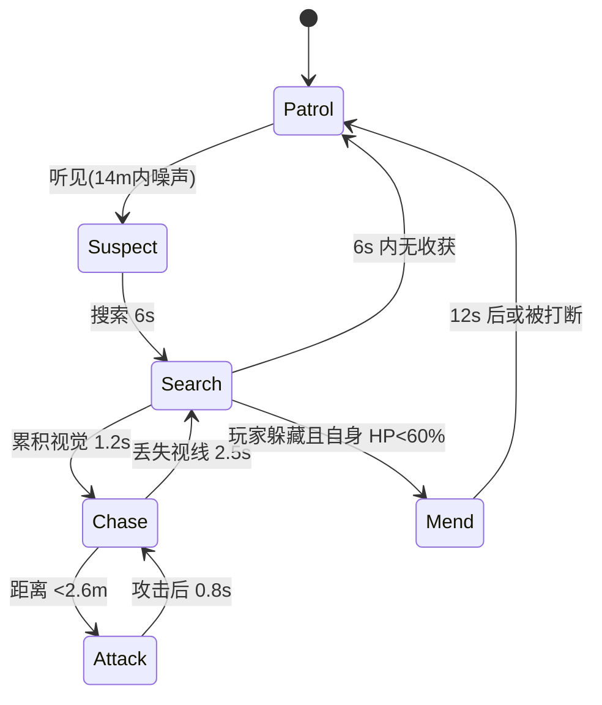

# 角色单页：缝合者

- 编号：EN_01　所属：霜脊隘口
- 关联：05 剧情、07 角色、04 玩法、08 建模、09 动画、10 音频

> 本文是**角色范文**，演示三类最容易被写成形容词的部位怎么变成可派工数字：
> 外观（§3 剪影与形状语言）、AI（§6 状态机+速度差）、数值（§7 与战斗时长互算）。

## 1. 基本信息

| 项 | 内容 |
|---|---|
| 类型 | 敌人（精英，非 BOSS） |
| 首次出场 | LV_01 |
| 出场频率 | 每关 2-4 次；Boss 关不出 |
| 故事功能 | 压迫者 |
| 玩法功能 | 追击 + 消耗（逼玩家放弃搜刮） |
| 目标情绪 | 玩家见到他应感到"再搜一个抽屉就要付出代价" |

## 2. 背景与性格

- 欲望 want：继续"修补"——把散落的人体部件接回去；需求 need：停止，但它已无法停止
- 谎言："我是在救人"；真相："我在把活人变成素材"；弧光转折：beat 7（玩家看见它给自己缝合）
- 说话方式：语速极慢（约 2.5 字/秒，正常对白 4-5）、用词为医学术语混日常词、口头禅"这里……不合身"
- 可表演行为（不是形容词）：紧张时反复摸自己左手腕的接缝；放松时（未发现玩家）会数手里的零件
- 关系：与 CH_01（玩家）"材料与工匠"；与 NPC_02（护士）曾是同事，它仍称呼她为"护士长"

## 3. 外观设定（美术需求）

- 年龄/体型/身高 190cm/头身比 6.8（比常人瘦长）；肩宽 0.48m、臂展 2.05m（+8% 于身高，制造威胁感）
- 服装（年代/层次/破损/污渍）：1990s 医院手术服，外罩已硬化的围裙；袖口与领口有长期血渍分层（3 层：旧褐→新红）
- 标志物/随身物：左手腕明显缝合线（主角每次遭遇都会注意到它摸这里）；腰间挂一把长 32cm 的骨锯（非武器，纯道具）
- 形状语言：**三角**（窄肩尖顶、下垂长臂、头部前倾）；剪影特征：**头部前倾 15° + 双臂长度超过膝盖**，任何光照下都能一眼识别
- 主色/辅色/点缀：主色病号绿 #6E7B62 / 辅色暗褐 #3B2E28 / 点缀血红 #7A1F1F（仅缝合线，占画面 <2%）
- 场景跳出策略：走廊冷白 #9FB3C8 环境下，它的绿偏黄 → 色相差约 30°，比同类敌人更容易被"扫到"
- 概念图需求：三视图、头部细节（前倾姿态下）、服装细节（围裙分层）、关键道具（骨锯）、表情包 ≥6 种（含"发现猎物"与"修补中"）
- 怪物专用：恐怖来源=**不协调的比例**（臂长、头前倾）而非血腥；本章正面露出时长=首次遭遇 8s 内不超过 3s 正面；声音先于本体=是（提前 6-10s 可听见拖动声）；尺度分级风险=血腥程度中等，评级预计 16+

## 4. 建模规格

| 项目 | 数值 |
|---|---|
| 引擎命名 | SK_EN_Suture |
| LOD0 三角面 | 52,000（敌人档 40k-80k 中位） |
| 骨骼数 | 68（含 8 根手指骨 ×2、下颌 1） |
| 贴图尺寸 | 2048（敌人档） |
| 材质 | PBR，RMA 打包（R=Rough G=Metallic B=AO，见 08） |
| LOD | 3 级（100%/50%/25%）+ impostor（仅在远景列队场景用） |
| 面部 blendshape | 12（风格化档 ≥20 的一半，因其面部被绷带遮挡 60%，不需要全表情） |

> 注：blendshape 只做 12 个是**有意低于 07 的"风格化 ≥20"**，理由是面部遮挡率高。这类偏差必须写出来，否则会被当成偷工。

## 5. 动作集（→ 09 动画单页）

| 动作 | 动画编号 | 说明 |
|---|---|---|
| locomotion（待机/潜行接近/加速/停顿） | AN_EN01_Locomotion | 待机时持续轻微摇晃（无法静止） |
| 攻击·挥砍 | AN_EN01_Slash | 主伤害手段，见 §7 |
| 攻击·抓取 | AN_EN01_Grab | 抓住玩家 → 进入 QTE，见 system SYS_04 |
| 受击（轻/重） | AN_EN01_Hit_L / _H | 轻击不打断，重击打断（韧性见 §7） |
| 死亡 | AN_EN01_Death | 倒地后仍有 1.5s 抽搐（成本低、压迫感强） |
| 交互/表演 | AN_EN01_Mend | 给自己缝合，仅在玩家躲藏时播放 |

## 6. AI / 行为（敌人与功能性 NPC）

- 感知：视觉 18m / FOV 100°（比常规敌人窄，因其头前倾视野受限）；听觉噪声半径 14m；感知积累 1.2s、衰减 0.8s
- 状态机：

- 逐状态：

| 状态 | 进入条件 | 行为 | 时长 | 退出条件 |
|---|---|---|---|---|
| 巡逻 | 默认 | 沿固定 3 点循环，移动 1.1 m/s，每点停留 4s 做"数零件" | 循环 | 感知触发 |
| 搜索 | 听见或瞥见 | 朝声源移动 1.8 m/s，到点后原地转 360° | 6s | 无收获回巡逻 / 确认目标进追击 |
| 追击 | 视觉累积 1.2s | 移动 3.4 m/s（玩家冲刺 4.2） | 持续 | 丢失视线 2.5s / 进入攻击距离 |
| 攻击 | 距离 <2.6m | 前摇 0.55s / 伤害 22 / 冷却 1.4s | 单次 | 攻击结束 |
| 修补 | 玩家躲藏且自身 HP<60% | 原地静止 12s，每秒回 4 HP | 12s | 受击打断 / 时间到 |

- 速度差设计：**追击 3.4 vs 玩家冲刺 4.2 → 差 0.8 m/s（19%）**。玩家永远能靠直线冲刺拉开，但转角与关门会吃掉这 19%——速度差存在的意义是"必须跑，但跑得掉"，而不是"必定被抓"。**禁止**把追击速度调到 ≥ 玩家冲刺，那会变成必死判定。
- 被关门/阻挡时行为：绕路最多 2 次尝试（每次 ≤3s），失败则转 Search 并在门后停留 4s（给玩家"它还在"的压迫感，但不破门——破门留给 BOSS）
- 绕路/破墙：不破墙、不破门（这是它与 BOSS 的行为区分点）

## 7. 数值（→ 04）

| HP | 伤害 | 硬直 | 韧性 | 弱点倍率 | 掉落 | 预期战斗时长 |
|---|---|---|---|---|---|---|
| 320 | 22（挥砍）/ 30（抓取成功后 QTE 失败） | 受击 0.35s；重击 0.8s | 60（单次 ≥20 伤害才打断） | 头部 1.5×；缝合线 2.0× | 医用胶带 ×1（必掉）；骨锯（首次击杀掉落，任务道具） | **22-30s** |

> **时长是怎么算出来的（不是拍的）**：
> 玩家中期 DPS 约 13-16（单手武器），320 HP → 纯输出 20-25s；
> 加上它每 8-10s 一次的位移拉开距离（每次约 2s 无效输出）→ 总时长 22-30s。
> 若换双手重武器（DPS 22 但攻速慢），HP 不变 → 15-20s，符合"重武器更快但更危险"的设计意图。

## 8. 声音需求（→ 10）

- 嗓音：男性、45-55 岁、沙哑气声（像长期不用嗓），音量偏低（永远比玩家想象中的近，制造误判）
- 脚步材质表：瓷砖（脆响）→ 走廊；木板（闷）→ 房间；湿地（黏）→ 血泊区
- 非语义语音：受击=短促气音（非痛呼，它不觉得疼）/ 死亡=长呼气后停止 / 发力=喉咙深处的挤压声 / 警觉=一声吸气（极其轻微，是玩家的核心听觉线索）
- 主题动机：单音持续（一个音，不构成旋律），发现玩家时升高半音——用最小变化标记状态切换

## 9. 验收测试

- [ ] 每个 AI 状态的触发测试：巡逻→搜索（在 14m 处扔物）、搜索→追击（正面进入 18m 且停留 1.2s）、追击→搜索（躲入柜内 2.5s）、修补（HP 降至 55% 且玩家躲藏）
- [ ] 卡视野/绕圈/蹲伏/关灯等边界：躲在门后是否被追；绕同一根柱子 3 圈是否会脱战（预期：会，因丢失视线 2.5s 触发）
- [ ] 模型/动画/声音在引擎内联动验收：缝合线受击时是否触发 2.0× 弱点提示音；「警觉吸气」是否在发现前 0.5s 播放

## 完成定义

- [x] 外观概念图需求完整，剪影可辨认（头前倾 15° + 臂长过膝，已做剪影测试）
- [x] 面数/骨骼/贴图/LOD 符合 08 与 11（52k / 68 骨 / 2048）
- [x] 动作全部映射到 09 单页（6 个动画编号）
- [x] 状态机逐状态量化，速度差设计明确（3.4 vs 4.2，19%）
- [x] 数值含预期战斗时长，声音需求齐全（22-30s，含推导过程）
