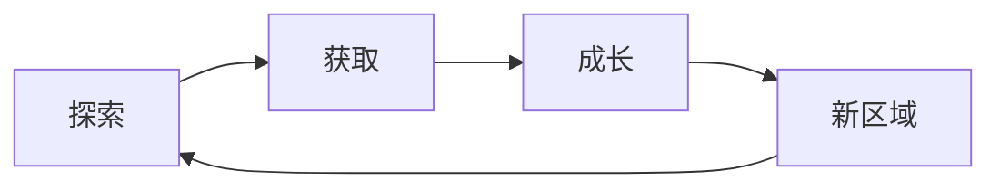

# 01 愿景与 Pitch —— {{GAME_NAME}}

- 文档编号：DOC_01　版本：v0.1　状态：草稿　更新：{{DATE}}　负责人：【待确认】
- 关联：全部文档

## 1. 电梯陈述

**一句话**：一款【题材/类型】游戏：玩家在【独特世界】中，通过【核心动作】，解决【核心冲突】，体验【核心情绪】。它像【对标 A】遇到【对标 B】，但【差异化】。

**三句话版**：
1. 【世界观+主角处境】
2. 【核心玩法】
3. 【核心情绪/独特卖点】

## 2. 核心支柱（3 条，不可妥协）

1. **支柱名**：解释。→ 因此我们做：【】；不做：【】
2. **支柱名**：解释。→ 因此我们做：【】；不做：【】
3. **支柱名**：解释。→ 因此我们做：【】；不做：【】

## 3. 核心乐趣与玩家幻想

- 10 秒循环：【操作→反馈】
- 30 秒循环：【】
- 10 分钟循环：【】
- 玩家幻想：「我是一个 ______ 的人，正在 ______，我感到 ______」

## 4. 核心循环

每一环的再玩动机：【】

## 5. 对标分析

| 对标 | 学什么（具体机制/表现） | 不学什么 |
|---|---|---|
| 【游戏A】 | 【】 | 【】 |
| 【游戏B】 | 【】 | 【】 |
| 【影视/其他】 | 【】 | 【】 |

## 6. 目标受众与平台

- 受众画像：年龄 / 常玩游戏 / 标签 / 恐怖或血腥容忍度：【】
- 平台：PC（最低/推荐）、Steam Deck、主机：【】
- 输入：键鼠 / 手柄：【】
- 可传播时刻（直播/视频）：【至少 3 个】

## 7. 卖点与商店钩子

- 5 个 Steam 特性 bullet（特性+玩家价值）：
  1. 【】
  2. 【】
  3. 【】
  4. 【】
  5. 【】
- 标题语（一句话）：【】
- 预告片镜头（至少 3 个）：【】

## 8. 范围与不做清单

- 流程时长：【】小时；场景数：【】；敌人种类：【】；武器/道具：【】；结局数：【】
- **明确不做**：
  - 【】
  - 【】

## 9. 商业与里程碑

- 定价区间：【】；同类销量参照：【】
- 团队规模：【】；开发周期：【】
- 垂直切片：【】；EA（若有）：【】；1.0：【】

## 完成定义

- [ ] 陌生人能凭一句话复述玩法
- [ ] 3 条支柱能否决设计，每条含「不做什么」
- [ ] 核心循环闭环且经灰盒原型验证
- [ ] 对标表具体到机制
- [ ] 数字锚点与不做清单明确
- [ ] 5 个卖点可直接用于商店页
