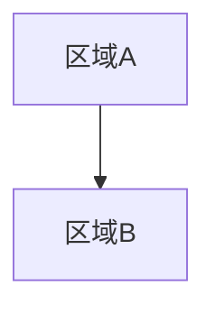

# 03 场景与关卡 —— {{GAME_NAME}}

- 文档编号：DOC_03　版本：v0.1　状态：草稿　更新：{{DATE}}　负责人：【待确认】
- 关联：02、04、05、08、10、11
- 说明：本文件只放规则与索引；每个场景/关卡用脚手架生成单页，放入 `scenes/`、`levels/`

## 场景索引

| 编号 | 名称 | 所属章节 | 类型 | 预计停留 | 状态 | 单页 |
|---|---|---|---|---|---|---|
| SC_01 | 【】 | 【】 | 探索/战斗/解谜 | 【】 | 草稿 | [链接](scenes/SC_01_xxx.md) |
|  |  |  |  |  |  |  |

## 关卡索引

| 编号 | 名称 | 所属章节 | 预计时长 | 强度峰值 | 状态 | 单页 |
|---|---|---|---|---|---|---|
| LV_01 | 【】 | 【】 | 【】 | 【】 | 草稿 | [链接](levels/LV_01_xxx.md) |
|  |  |  |  |  |  |  |

## 世界总图

- 世界分区与连接关系（Mermaid 或引用概念图编号）：

- 区域解锁顺序与所需能力（反向校验无死局）：

| 区域 | 首次进入所需能力 | 来源关卡/系统 |
|---|---|---|
| 【】 | 【】 | 【】 |

## 全局规则（所有场景单页遵守）

- 引导手法优先级：光 → 色 → 地形 → 声音；各场景记录具体用法
- 地标间隔：【】秒步行；防迷路三件套：地标/环形回路/单向门后新视野
- 场景切换：加载方式、检查点规则（引用 03 参考文档与 11）
- 环境声分区与混响区规则：引用 10
- 性能预算：各场景可见三角面 / DC / 流式分区：引用 11

## 完成定义

- [ ] 每个场景、每个关卡都有单页且索引齐全
- [ ] 区域解锁无死局
- [ ] 全部叙事道具与 05 对齐、环境资产与 08 对齐
- [ ] 全部编号可跳转，无悬空引用

## 变更记录

| 版本 | 日期 | 改动 |
|---|---|---|
| v0.1 | {{DATE}} | 初稿 |
