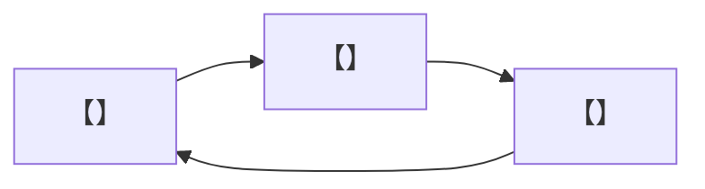

# 04 玩法系统 —— {{GAME_NAME}}

- 文档编号：DOC_04　版本：v0.1　状态：草稿　更新：{{DATE}}　负责人：【待确认】
- 关联：01、06、07、09、11
- 说明：每个系统单页放 `systems/`；本文件放循环、系统清单、跨系统规则、数值总表

## 1. 核心循环（三层）

- 即时循环（秒级）：【】
- 关卡循环（分钟级）：【】
- 元循环（小时级）：【】

## 2. 系统清单

| 编号 | 系统 | 支柱 | 优先级 | 状态 | 单页 |
|---|---|---|---|---|---|
| SYS_01 | 【】 | 【】 | Must | 草稿 | [链接](systems/SYS_01_xxx.md) |
| SYS_02 | 【】 | 【】 | Must | 草稿 |  |
|  |  |  |  |  |  |

## 3. 战斗总表（有战斗时）

| 武器/招式 | 前摇(帧/s) | 判定帧 | 后摇 | 可取消窗口 | 伤害 | 削韧 | 体力消耗 |
|---|---|---|---|---|---|---|---|
| 【】 | 【】 | 【】-【】 | 【】 | 【】-【】 | 【】 | 【】 | 【】 |

- 命中反馈统一值：hitstop【】帧；震屏幅度【】；震动【】；相机冲击【】
- 难度档位参数：

| 参数 | 剧情 | 标准 | 困难 |
|---|---|---|---|
| 敌人 HP 倍率 | 【】 | 1.0 | 【】 |
| 敌人伤害倍率 | 【】 | 1.0 | 【】 |
| 资源供给 | 【】 | 1.0 | 【】 |
| 提示频率 | 【】 | 标准 | 【】 |

## 4. 资源 Source / Sink

| 资源 | 来源（速率/关卡） | 消耗出口 | 持有上限 | 期望行为 |
|---|---|---|---|---|
| 【】 | 【】 | 【】 | 【】 | 【】 |

逐关资源压力模拟：

| 关卡 | 进入持有 | 预计消耗 | 本关补给 | 结算持有 | 压力评价 |
|---|---|---|---|---|---|
| LV_01 | 【】 | 【】 | 【】 | 【】 | 【】 |

## 5. 成长与解锁

| 能力 | 效果（量化） | 解锁位置 | 可否错过 | 影响哪些关卡 |
|---|---|---|---|---|
| 【】 | 【】 | 【】 | 【】 | 【】 |

## 6. 手感总表（Game Feel）

| 项 | 做/不做 | 参数 |
|---|---|---|
| 输入缓冲 | 【】 | 150ms |
| 土狼时间 | 【】 | 100ms |
| 命中停顿 | 【】 | 轻【】/重【】 |
| 震屏 | 【】 | 幅度【】 |
| 手柄震动 | 【】 | 【】 |
| 粒子/音效反馈 | 【】 | 100ms 内 |
| 自适应扳机 | 【】 | 【】 |
| 脚步材质反馈 | 【】 | 引用 10 |

## 7. 数值表

- 全部数值由外部表驱动（CSV/电子表格 → JSON/ScriptableObject），路径：【】
- 数值表版本：【】　最后更新：【】

## 完成定义

- [ ] 每个 Must 系统有单页（状态机/参数/边界/存档/验收）
- [ ] 战斗帧数据与 09 动画一致
- [ ] 资源压力模拟无卡死/无富余
- [ ] 成长无死局缺口
- [ ] 手感清单逐项给值
- [ ] 无硬编码数值
