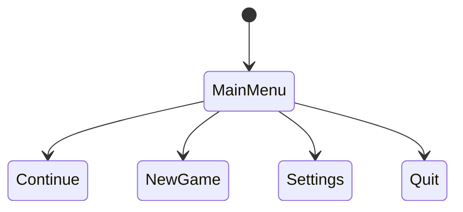

# 06 交互与 UI/UX —— {{GAME_NAME}}

- 文档编号：DOC_06　版本：v0.1　状态：草稿　更新：{{DATE}}　负责人：【待确认】
- 关联：04、07、09、10、11

## 1. 玩家动词表

| 动词 | 键鼠 | 手柄 | 上下文 | 进入/退出条件 | 动画/系统 |
|---|---|---|---|---|---|
| 【】 | 【】 | 【】 | 【】 | 【】 | 【】 |

按住/点按规则：高风险动作（【】）按住；常用动作（【】）点按。

## 2. 交互矩阵

| 对象＼动词 | 观察 | 使用 | 推 | 躲藏 | 拾取 | 攻击 |
|---|---|---|---|---|---|---|
| 门 | 【】 | 【】 | 【】 | 【】 | 【】 | 【】 |
| 柜子 | 【】 | 【】 | 【】 | 【】 | 【】 | 【】 |
| 【】 | 【】 | 【】 | 【】 | 【】 | 【】 | 【】 |

## 3. 上下文交互

- 主交互键：键鼠【】；手柄【】
- 多目标优先级：最近 + 视线中心；最大角度【】°、距离【】m
- 三层反馈：确认（图标+音效，0ms）→ 过程（进度【】s）→ 结果（状态变化+音效+震动）

## 4. 操作延迟预算

| 动作 | 按键到画面响应 | 前摇动画 | 达标 |
|---|---|---|---|
| 攻击 | 【】ms | 【】帧 | □ |
| 闪避 | 【】ms | 【】帧 | □ |
| 交互 | 【】ms | — | □ |
| 全局上限 | ≤100ms |  |  |

## 5. 教学埋点

| 机制 | 教学时刻（关卡/beat） | 环境示范 | 安全试错 |
|---|---|---|---|
| 【】 | 【】 | 【】 | 【】 |

## 6. UI 资产总表

| 编号 | 界面 | 触发 | 是否暂停 | 元素 | 状态 |
|---|---|---|---|---|---|
| UI_HUD | 常驻 HUD | 游戏中 | 否 | 【】 | 草稿 |
| UI_MENU | 主菜单 | 启动 | 是 | 【】 | 草稿 |
| UI_SET | 设置 | 菜单 | 是 | 【】 | 草稿 |
| UI_INV | 背包 | 【】 | 【】 | 【】 | 草稿 |
| UI_MAP | 地图 | 【】 | 【】 | 【】 | 草稿 |
| UI_DOC | 文档/图鉴 | 【】 | 【】 | 【】 | 草稿 |
| UI_SUB | 字幕 | 过场/对话 | 否 | 【】 | 草稿 |

## 7. HUD 线框

- 安全区：距屏幕边 ≥5%；16:9 与 21:9 适配：【】
- 常驻元素：【】；危险时浮现：【】
- （附线框图编号：【】）

## 8. 菜单流程

- 设置项清单：画面（分辨率/全屏/垂直同步/帧率上限/DLSS-FSR/FOV/动态模糊/颗粒/色差）/声音（四总线）/控制（重映射/灵敏度/反转/死区）/游戏性（难度/字幕/提示）/可访问性

## 9. UI 视觉规范

- 字体：标题【】正文【】（授权确认：【】）；HUD ≥18px@1080p；字幕 ≥28px
- 按键图标四套：键鼠 / Xbox / PS / Deck
- 动效：切换 150-250ms，缓动【】；按钮四态音画反馈

## 10. 可访问性

- [ ] 色盲三模式，且不靠颜色单一编码
- [ ] 按键完全重映射、完全手柄支持、键鼠全功能
- [ ] QTE 可改长按/自动；瞄准辅助
- [ ] 字幕开关/字号/说话人/背景透明度
- [ ] 闪烁内容 <3Hz 或光敏警告
- [ ] 声音信息可视化（方向提示）

## 完成定义

- [ ] 动词表+交互矩阵无死角，本能操作均有反馈
- [ ] 延迟逐动作 ≤100ms
- [ ] 全部 UI 有状态图，3 次操作内继续游戏
- [ ] 字体授权、四套图标、字号达标
- [ ] 可访问性与本地化项全部落实

## 变更记录

| 版本 | 日期 | 改动 |
|---|---|---|
| v0.1 | {{DATE}} | 初稿 |
