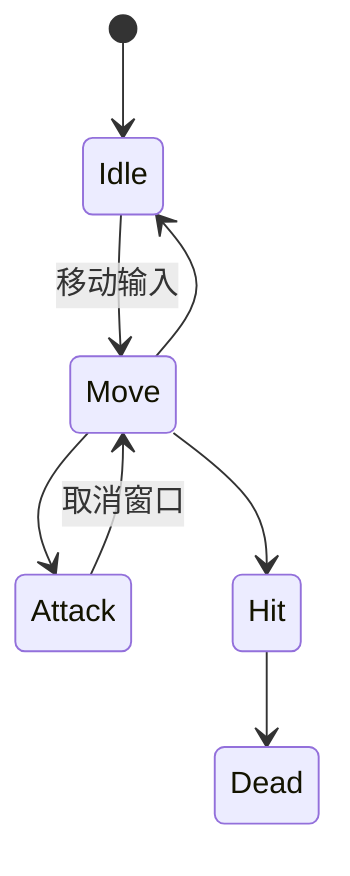

# 09 动画规格 —— {{GAME_NAME}}

- 文档编号：DOC_09　版本：v0.1　状态：草稿　更新：{{DATE}}　负责人：【待确认】
- 关联：04、06、07、08、10
- 说明：每条动画单页放 `animations/`；3D 与 2D 帧动画两套规范

## 一、3D 全局规范

- 采样：60fps；帧数与秒数双写
- 骨骼命名：`Hips/Spine/Neck/Head/L_UpperArm/...`；人形可重定向
- 面部：写实 ≥52 ARKit blendshape；风格化 ≥20
- 命名：`AN_角色_动作_序号`；源文件 `.blend/.ma` 归档，导出 `.fbx`

## 二、各角色状态机索引

### 主角（CH_Player）

- 过渡时长：常规 0.1-0.25s；受击打断 0.05-0.1s
- 上半身层：【瞄准/持物】；叠加层：【呼吸/受伤/颤抖】
- 详细状态机在角色单页 `characters/`

## 三、动画总索引

| 编号 | 角色 | 动作 | 状态机位置 | 时长(帧/s) | 根运动 | 状态 |
|---|---|---|---|---|---|---|
| AN_Player_Idle_01 | 玩家 | 待机 | Idle | 循环 | 否 | 草稿 |
| AN_Player_Walk_01 | 玩家 | 走 | Move | 循环 | 否 | 草稿 |
| AN_Player_Run_01 | 玩家 | 跑 | Move | 循环 | 否 | 草稿 |
| 【】 | 【】 | 【】 | 【】 | 【】 | 【】 | 【】 |

## 四、2D 帧动画规范（项目含 2D 元素时）

- 帧率：【12/15/24】fps；张数：走 6-8、跑 4-6、攻击 6-10、受击 2-4、死亡 8-16
- 方向数：【】；单帧尺寸（2×最大显示）：【】；PPU：【】
- 像素风：固定色板【】、禁子像素、整数倍缩放
- 图集：等大格、padding【】px、命名 `T_SP_角色_动作集_帧数`；元数据 JSON
- 枢轴统一：【脚底中心】

## 五、过场动画索引

| 编号 | 名称 | 镜头数 | 时长 | 动画师状态 |
|---|---|---|---|---|
| 【】 | 【】 | 【】 | 【】 | 草稿 |

## 完成定义

- [ ] 每个角色状态机完整（移动/动作/受击/死亡/过场）
- [ ] 每条动画三段式帧区间与 04 战斗表一致
- [ ] 事件帧逐帧埋点（判定/脚步/音效/特效/相机/根运动）
- [ ] 无滑步、口型 ≤2 帧
- [ ] 2D 帧动画规格（帧率/张数/图集/色板/枢轴）齐全
- [ ] 过场可跳过且跳过后状态一致

## 变更记录

| 版本 | 日期 | 改动 |
|---|---|---|
| v0.1 | {{DATE}} | 初稿 |
