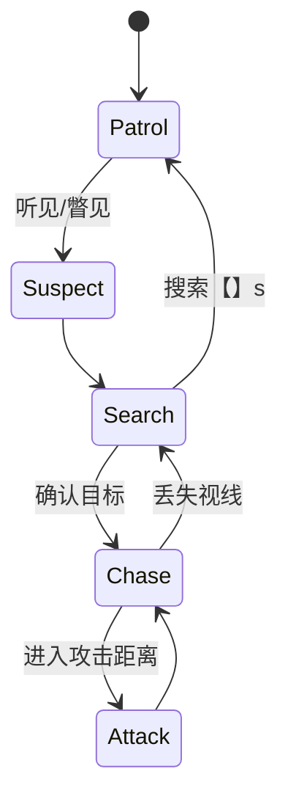

# 角色单页：{{ITEM_NAME}}

- 编号：{{PREFIX}}_{{NUMBER}}　所属：{{GAME_NAME}}　版本：v0.1　状态：草稿
- 更新：{{DATE}}　负责人：【待确认】
- 关联：05 剧情、07 角色、04 玩法、08 建模、09 动画、10 音频

## 1. 基本信息

| 项 | 内容 |
|---|---|
| 类型 | 主角 / 敌人 / NPC / 怪物 |
| 首次出场 | 【LV_##】 |
| 出场频率 | 【】 |
| 故事功能 | 引导者/压迫者/镜像/牺牲者 |
| 玩法功能 | 教学/追击/消耗/补给/解谜 |
| 目标情绪 | 玩家见到他应感到【】 |

## 2. 背景与性格

- 欲望 want：【】　需求 need：【】
- 谎言：【】　真相：【】　弧光转折：beat【】
- 说话方式：语速【】、用词【】、口头禅【】
- 可表演行为（不是形容词）：紧张时【】、放松时【】
- 关系：与【】的关系【】

## 3. 外观设定（美术需求）

- 年龄/体型/身高【】cm/头身比【】
- 服装（年代/层次/破损/污渍）：【】
- 标志物/随身物：【】
- 形状语言：【方/圆/三角】；剪影特征【】
- 主色/辅色/点缀：【】；场景跳出策略：【】
- 概念图需求：三视图、头部细节、服装细节、关键道具、表情包（≥6 种）
- 怪物专用：恐怖来源【】；本章正面露出时长【】；声音先于本体？【】；尺度分级风险【】

## 4. 建模规格

| 项目 | 数值 |
|---|---|
| 引擎命名 | SK_【】 |
| LOD0 三角面 | 主角 60k-100k / 敌人 40k-80k / NPC 15k-40k |
| 骨骼数 | 【】 |
| 贴图尺寸 | 主角 4096 / NPC 2048 |
| 材质 | PBR，通道打包见 08 |
| LOD | 3 级（100%/50%/25%）+ impostor |
| 面部 blendshape | 写实 ≥52 / 风格化 ≥20 |

## 5. 动作集（→ 09 动画单页）

| 动作 | 动画编号 | 说明 |
|---|---|---|
| locomotion（待机/走/跑/蹲/跳/落地/转身） | AN_【】 | 【】 |
| 攻击/技能 | AN_【】 | 【】 |
| 受击/死亡 | AN_【】 | 【】 |
| 交互/表演 | AN_【】 | 【】 |

## 6. AI / 行为（敌人与功能性 NPC）

- 感知：视觉【】m / FOV【】°；听觉噪声半径【】；感知积累【】s、衰减【】s
- 状态机：

- 逐状态：

| 状态 | 进入条件 | 行为 | 时长 | 退出条件 |
|---|---|---|---|---|
| 巡逻 | 【】 | 【】 | 【】 | 【】 |
| 追击 | 【】 | 速度【】m/s（玩家冲刺【】） | 【】 | 【】 |
| 攻击 | 【】 | 前摇【】s/伤害【】/冷却【】s | 【】 | 【】 |

- 速度差设计：【】；被关门/阻挡时行为【】；绕路/破墙【】

## 7. 数值（→ 04）

| HP | 伤害 | 硬直 | 韧性 | 弱点倍率 | 掉落 | 预期战斗时长 |
|---|---|---|---|---|---|---|
| 【】 | 【】 | 【】 | 【】 | 【】 | 【】 | 35-45s |

## 8. 声音需求（→ 10）

- 嗓音：性别【】年龄【】音色【】
- 脚步材质表：【】；呼吸/喘息规则：【】
- 非语义语音：受击【】/死亡【】/发力【】/警觉【】
- 主题动机：【】

## 9. 验收测试

- [ ] 每个 AI 状态的触发测试：【】
- [ ] 卡视野/绕圈/蹲伏/关灯等边界：【】
- [ ] 模型/动画/声音在引擎内联动验收

## 完成定义

- [ ] 外观概念图需求完整，剪影可辨认
- [ ] 面数/骨骼/贴图/LOD 符合 08 与 11
- [ ] 动作全部映射到 09 单页
- [ ] 状态机逐状态量化，速度差设计明确
- [ ] 数值含预期战斗时长，声音需求齐全
