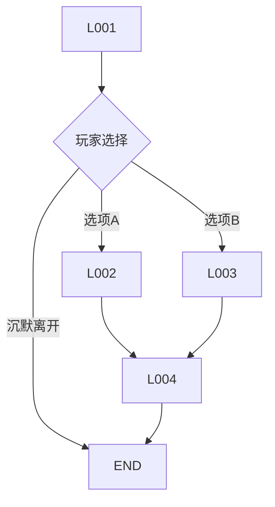

# 对话/过场单页：{{ITEM_NAME}}

- 编号：DL_{{NUMBER}}　所属：{{GAME_NAME}}　版本：v0.1　状态：草稿
- 更新：{{DATE}}　负责人：【待确认】
- 关联：05 剧情、03 场景、07 角色、09 动画、10 音频

## 1. 元信息

| 项 | 内容 |
|---|---|
| 所属 beat / 场景 | beat【】/【SC_##】 |
| 触发条件 | 进入区域 / 拾取【】 / 事件【】 |
| 参与角色 | 【】 |
| 玩家状态 | 锁定 / 可走动 / 过场 |
| 可否跳过 | 是/否；中断规则：被发现时【】 |
| 总时长 | 【】s（配音后回填） |
| 进入姿态 | 【】 |
| 退出姿态与位置 | 【】（须与玩法衔接，禁止传送） |

## 2. 台词表（每条 ID 唯一；key = ID，禁止硬编码）

| ID | 说话人 | 中文台词 | 语气（可表演） | 动作/表情 | 镜头/站位 | 触发/等待 | 时长(s) | EN |
|---|---|---|---|---|---|---|---|---|
| DL_##_L001 | 【】 | 【】 | 【】 | 【】 | 【】 | 【】 | 【】 | 【】 |
|  |  |  |  |  |  |  |  |  |

标注约定：`…` 停顿；`【粗：…】` 重音；`（喘气）` 表演提示。
字幕合规：单条 ≤2 行 × 18-20 汉字；中文约 4-5 字/秒。

## 3. 分支对话树（若有）

| 节点 | 选项文本 | 条件（flag/道具） | 后果 | 汇合点 |
|---|---|---|---|---|
| 【】 | 【】 | 【】 | 【】 | 【】 |

- 时间限制【】；后果是否显示【】；沉默选项【】；关键信息回看途径【】

## 4. 镜头表（过场）

| 镜号 | 景别 | 机位运动 | 时长(s) | 画面 | 台词 ID | 音效/音乐 |
|---|---|---|---|---|---|---|
| 1 | 远/全/中/近/特写 | 【】 | 【】 | 【】 | 【】 | AU_【】 |

## 5. 配音交接

- 从本表生成配音单：48kHz、干声、单句一文件、命名 `VO_角色_场景_序号.wav`
- 非语义语音：【】
- 语种：首发配音【】；其他语种字幕【】

## 完成定义

- [ ] 每条台词 ID 唯一、语气可表演、时长估算、字幕合规
- [ ] 分支树收敛，关键信息可回看
- [ ] 过场镜头表完整，进出衔接无传送
- [ ] 配音单生成，字符串全部外部化（含 EN 字段）
- [ ] 跳过/中断后状态与播完一致
