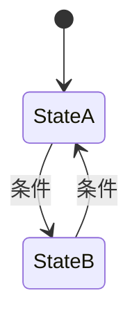

# 系统单页：{{ITEM_NAME}}

- 编号：SYS_{{NUMBER}}　所属：{{GAME_NAME}}　版本：v0.1　状态：草稿
- 更新：{{DATE}}　负责人：【待确认】
- 关联：04 玩法、06 交互、09 动画、10 音频、11 技术

## 1. 目的与玩家幻想

- 解决什么体验：【】
- 支撑哪条核心支柱：【】
- 玩家幻想：【】

## 2. 输入 → 输出

| 玩家输入（按键见 06） | 系统处理 | 输出（状态/反馈/数值） |
|---|---|---|
| 【】 | 【】 | 【】 |

## 3. 规则与状态机

| 状态 | 进入条件 | 行为 | 退出条件 |
|---|---|---|---|
| 【】 | 【】 | 【】 | 【】 |

## 4. 参数表（全部量化，数值由外部表驱动）

| 参数 | 类型 | 默认值 | 范围 | 设计意图 |
|---|---|---|---|---|
| 【】 | float | 【】 | 【】-【】 | 【】 |
| 【】 |  | 【】 | 【】 | 【】 |

## 5. 边界与异常

| 情况 | 处理 |
|---|---|
| 玩家死亡 | 【】 |
| 存档/读档 | 【】 |
| 暂停/过场中断 | 【】 |
| 物品栏满 | 【】 |
| 重复触发/连点 | 【】 |
| 网络中断（若联网） | 【】 |

## 6. 系统交互（接口）

| 调用对象 | 事件/接口 | 触发时机 |
|---|---|---|
| SYS_【】 | OnXxx(参数) | 【】 |
| 【】 | 【】 | 【】 |

## 7. 存档字段

| 字段 | 类型 | 默认值 | 说明 |
|---|---|---|---|
| 【】 | 【】 | 【】 | 【】 |

## 8. 反馈与手感（引用 04 手感表）

| 时机 | 音效 | 特效 | 震屏/震动 | UI |
|---|---|---|---|---|
| 成功 | AU_【】 | 【】 | 【】 | 【】 |
| 失败 | AU_【】 | 【】 | 【】 | 【】 |

原则：每个动作 100ms 内有视听触反馈。

## 9. 验收测试用例

1. [ ] 【输入操作】→【预期结果】
2. [ ] 【边界条件】→【预期处理】
3. [ ] 【系统交互】→【预期事件】
4. [ ] 读档后状态正确恢复

## 完成定义

- [ ] 状态机完整、参数全部量化
- [ ] 边界情况全部有处理
- [ ] 接口与存档字段已与相关系统确认
- [ ] 反馈清单无 100ms 死角
- [ ] 全部测试用例通过

## 变更记录

| 版本 | 日期 | 改动 |
|---|---|---|
| v0.1 | {{DATE}} | 初稿 |
